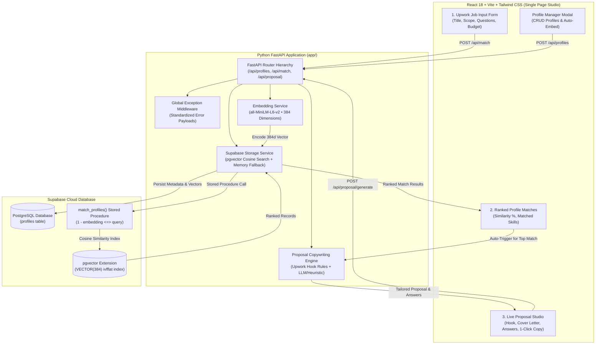

# ⚡ Upwork AI Matcher & Proposal Studio

A production-grade full-stack application built with **React (Vite + Tailwind CSS)**, **Python (FastAPI)**, and **Supabase (PostgreSQL + pgvector)**, powered by **free Hugging Face models**.

It automates the agency and freelancer workflow by storing profiles, computing dense vector embeddings, performing semantic similarity matching against incoming Upwork job requirements, and synthesizing high-converting Upwork proposals on a **unified single-page workspace**.

---

## 📑 Table of Contents

- [1. System Architecture](#1-system-architecture)
- [2. Key Features](#2-key-features)
- [3. Coding Standards & Architectural Principles](#3-coding-standards--architectural-principles)
- [4. UI Design Reference (SiGa HRMS Dashboard Aesthetic)](#4-ui-design-reference-siga-hrms-dashboard-aesthetic)
- [5. Tech Stack Overview](#5-tech-stack-overview)
- [6. Supabase Setup (PostgreSQL with pgvector)](#6-supabase-setup-postgresql-with-pgvector)
- [7. Environment Configuration](#7-environment-configuration)
- [8. Quick Start & Execution](#8-quick-start--execution)
- [9. API Reference Documentation](#9-api-reference-documentation)
- [10. Developer Extension Guide (Adding New Features)](#10-developer-extension-guide-adding-new-features)
- [11. Troubleshooting & FAQ](#11-troubleshooting--faq)

---

## 4. UI Design Reference (SiGa HRMS Dashboard Aesthetic)

The UI faithfully replicates the design system of **SiGa Systems HRMS Dashboard** (`https://hrms.sigasystems.com/dashboard`) with a clean, high-contrast **White Background Theme** by default (and optional Dark Theme toggle in the header).

### Design Tokens (1:1 from SiGa Systems CSS Variables)

| Token | Light (Default) | Dark Mode | Usage |
|---|---|---|---|
| `--background` | `#ffffff` | `hsl(222 32% 5%)` | Canvas / Page root |
| `--background-canvas` | `#f8fafc` | `#080c14` | Workspace main canvas |
| `--card` | `#ffffff` | `hsla(222, 26%, 11%, 0.85)` | Card surfaces |
| `--foreground` | `#0f172a` (Slate-900) | `hsl(210 20% 96%)` | High-contrast primary text |
| `--muted-foreground` | `#64748b` (Slate-500) | `hsl(215 16% 60%)` | Secondary labels & subheadings |
| `--border` | `#e2e8f0` (Slate-200) | `rgba(255,255,255,0.08)` | Crisp borders |
| `--primary` | `#f37935` | `#f37935` | SiGa Orange — CTA buttons, active state |
| `--secondary` | `#2c47a3` | `#2c47a3` | SiGa Blue — secondary actions |
| `--billable` | `#00a544` | `#00a544` | Green — hourly rates & active status |
| `--upwork` | `#00b3e1` | `#00b3e1` | Cyan — Upwork skill tags & badges |
| `--radius` | `0.35rem` | `0.35rem` | SiGa standard border radius |

### Visual Layout & Multi-Page Views (Clean & Spacious)
1. **Left Navigation Sidebar** (`Sidebar.jsx`): Clean white surface, SiGa Orange emblem, 3-page workspace navigation (`Job Matcher`, `Proposal Studio`, `Agency Talent Pool`), real-time infrastructure status indicators, and agency portal footer.
2. **Top Navigation Bar** (`Header.jsx`): Breadcrumb trail, fast page-switcher tab bar (`[ 🎯 Job Matcher ] [ ✍️ Proposal Studio ] [ 👥 Talent Pool ]`), Supabase pgvector health badge, and **Light/Dark Theme Switcher**.
3. **Summary Metric Cards** (`MetricStatsBar.jsx`): 4-column overview (Agency Profiles, Vector Store status, Top Match Score, and Upwork Proposal Engine).
4. **Dedicated Page Views (Uncongested Architecture)**:
   - **Page 1: 🎯 Job Matcher (`/matcher`)**: Spacious 2-column view (6 cols each) with clean Job Requirement inputs (collapsible screening questions) on the left, and spacious Ranked Candidate match cards with similarity gauges on the right.
   - **Page 2: ✍️ Proposal Studio (`/proposal`)**: Full distraction-free proposal drafting suite. Left column shows active job brief reference and client inbox 2-line preview hook; right column provides a large, comfortable cover letter editor and dedicated screening question answers with 1-click copy buttons.
   - **Page 3: 👥 Agency Talent Pool (`/profiles`)**: Full-page talent directory (replaces cramped modal) with candidate search, inline candidate registration drawer, hourly rates, skills chips, and 1-click proposal shortcuts.

---

## 1. System Architecture



---

## 2. Key Features

- **Unified Single-Page Split Workspace**:
  - The left column captures Upwork job details (title, description, budget/rate, client screening questions, and a 1-click sample loader).
  - The right column provides an integrated view containing **Profile Match Scorecards** at the top and the **Live Upwork Proposal Studio** at the bottom without navigating between multiple pages.
- **Supabase pgvector Similarity Matching**:
  - Persists candidate profiles and their 384-dimensional dense vectors generated by Hugging Face `all-MiniLM-L6-v2`.
  - Executes nearest-neighbor searches in sub-milliseconds using PostgreSQL cosine distance operators (`<=>`).
- **Interview-Winning Upwork Copywriting Engine**:
  - Implements the **2-Line Preview Rule**: The first 2 lines determine whether the client clicks your proposal in their Upwork inbox.
  - Eliminates robotic pleasantries (*"Dear Hiring Manager"*, *"I hope you are doing well"*, *"I am writing to express my interest"*).
  - Immediately hooks the client with their core problem, cites relevant portfolio projects from the candidate's actual history, and drafts clear answers to client screening questions.
- **Zero External API Cost Out-of-the-Box**:
  - Embeddings run 100% locally on CPU using `sentence-transformers`.
  - Supports free Hugging Face serverless generation models (`Qwen/Qwen2.5-72B-Instruct` or `meta-llama/Llama-3.2-3B-Instruct`), paired with an intelligent heuristic engine when an API key is not supplied.
- **Resilient Fallback Storage**:
  - If Supabase environment variables are missing or unconfigured, the backend automatically activates an in-memory cache with Python cosine similarity matching so all features can be evaluated instantly.

---

## 3. Coding Standards & Architectural Principles

This codebase strictly follows modern software engineering conventions:

### Python & FastAPI Backend
- **PEP 8 Compliance**: Strict naming conventions, consistent spacing, clean module layouts.
- **Full Type Hinting**: Every function, parameter, and return value is explicitly typed with `typing` and Pydantic schemas.
- **Separation of Concerns**:
  - `app/routers/`: Clean HTTP presentation layer with status codes and OpenAPI metadata.
  - `app/services/`: Isolated business logic (vector encoding, Upwork prompt engineering, database querying).
  - `app/models.py`: Strongly-typed Pydantic v2 domain schemas with validators and field constraints.
  - `app/database.py`: Centralized database client lifecycle management.
- **Global Error Handling**: Unhandled exceptions are intercepted by a global exception middleware in `app/main.py` and returned as standardized JSON payloads (`error`, `message`, `detail`, `timestamp`, `path`).
- **DRY (Don't Repeat Yourself)**:
  - Vector extraction and parsing from string/JSON/list is centralized in `_parse_vector()`.
  - Upwork hook composition is deduplicated across tone templates.
  - Local caching and fallback logic are unified in `supabase_service.py`.

### React Frontend
- **Component Modularity**: Single-responsibility components (`Header`, `JobRequirementForm`, `MatchResultsList`, `ProposalEditor`, `ProfileManagerModal`).
- **Standardized API Layer**: Centralized HTTP client in `frontend/src/services/api.js` with unified error handling and network timeout recovery.
- **Non-blocking UI Feedback**: Replaced standard blocking browser alerts with smooth, auto-dismissing toast notifications.
- **Tailwind CSS Utility Structure**: Clean visual hierarchy, responsive multi-column layouts, and dark mode styling.

---

## 4. Tech Stack Overview

| Layer | Technology | Purpose |
|---|---|---|
| **Frontend Framework** | **React 18 (Vite 5)** | Fast, responsive single-page client interface |
| **Styling** | **Tailwind CSS 3** | Utility-first responsive design & dark UI theme |
| **Icons** | **Lucide React** | Clean iconography for workspace controls |
| **Backend Framework** | **Python 3.10+ / FastAPI** | High-performance asynchronous REST API |
| **Database** | **Supabase (PostgreSQL 15+)** | Cloud database persistence with native pgvector |
| **Vector Engine** | **pgvector** | Native vector indexing (`ivfflat`) & cosine search (`<=>`) |
| **Embedding Model** | **`all-MiniLM-L6-v2`** | 384-dimensional dense vectors (100% free, local CPU inference) |
| **Proposal LLM** | **Hugging Face Inference API** | Free generation with Qwen 2.5 / Llama 3 & smart fallback |

---

## 5. Supabase Setup (PostgreSQL with pgvector)

To enable vector similarity search in your Supabase project:

1. Open your **Supabase Dashboard** -> Navigate to **SQL Editor**.
2. Click **New query**, paste the SQL script below, and click **Run**:

```sql
-- =========================================================================
-- Supabase Schema: Profiles and Vector Similarity Search with pgvector
-- =========================================================================

-- 1. Enable the pgvector extension
CREATE EXTENSION IF NOT EXISTS vector;

-- 2. Create the profiles table
CREATE TABLE IF NOT EXISTS profiles (
    id UUID PRIMARY KEY DEFAULT gen_random_uuid(),
    name TEXT NOT NULL,
    title TEXT NOT NULL,
    hourly_rate NUMERIC DEFAULT 0,
    bio TEXT NOT NULL,
    skills TEXT[] DEFAULT '{}',
    experience_summary TEXT DEFAULT '',
    portfolio_items JSONB DEFAULT '[]'::jsonb,
    past_proposals JSONB DEFAULT '[]'::jsonb,
    embedding VECTOR(384), -- 384 dimensions for all-MiniLM-L6-v2
    created_at TIMESTAMPTZ DEFAULT NOW(),
    updated_at TIMESTAMPTZ DEFAULT NOW()
);

-- 3. Create an ivfflat index for fast cosine distance matching
CREATE INDEX IF NOT EXISTS profiles_embedding_idx 
ON profiles 
USING ivfflat (embedding vector_cosine_ops)
WITH (lists = 100);

-- 4. Vector matching stored procedure
CREATE OR REPLACE FUNCTION match_profiles (
  query_embedding VECTOR(384),
  match_threshold FLOAT DEFAULT 0.0,
  match_count INT DEFAULT 5
)
RETURNS TABLE (
  id UUID,
  name TEXT,
  title TEXT,
  hourly_rate NUMERIC,
  bio TEXT,
  skills TEXT[],
  experience_summary TEXT,
  portfolio_items JSONB,
  similarity FLOAT
)
LANGUAGE sql STABLE
AS $$
  SELECT
    p.id,
    p.name,
    p.title,
    p.hourly_rate,
    p.bio,
    p.skills,
    p.experience_summary,
    p.portfolio_items,
    1 - (p.embedding <=> query_embedding) AS similarity
  FROM profiles p
  WHERE p.embedding IS NOT NULL
    AND 1 - (p.embedding <=> query_embedding) >= match_threshold
  ORDER BY p.embedding <=> query_embedding ASC
  LIMIT match_count;
$$;
```

---

## 6. Environment Configuration

Configuration is managed via `backend/.env`. Copy the template and add your credentials:

```ini
# Supabase API Credentials (Supabase Dashboard -> Project Settings -> API)
SUPABASE_URL=https://your-project-id.supabase.co
SUPABASE_KEY=your-supabase-anon-or-service-role-key

# Optional: Direct PostgreSQL URI (Supabase Dashboard -> Project Settings -> Database)
DATABASE_URL=

# Hugging Face Free Serverless Inference Token (https://huggingface.co/settings/tokens)
# Optional: If omitted, the application uses the built-in heuristic copywriting engine.
HF_TOKEN=

# Model Configuration
EMBEDDING_MODEL_NAME=sentence-transformers/all-MiniLM-L6-v2
HF_GENERATION_MODEL=Qwen/Qwen2.5-72B-Instruct

# Server Configuration
PORT=8000
HOST=0.0.0.0
```

---

## 7. Quick Start & Execution

### Option A: 1-Click Launch (Windows)
Double-click `run_app.bat` in the project root. This automatically starts:
- **FastAPI Backend**: `http://127.0.0.1:8000`
- **React Frontend**: `http://localhost:5173`
- Launches your default web browser to the application dashboard.

### Option B: Manual Terminal Execution

```bash
# 1. Start the FastAPI Backend
cd backend
python -m uvicorn app.main:app --host 127.0.0.1 --port 8000 --reload

# 2. In a separate terminal, start the React Vite Server
cd frontend
npm run dev
```

Visit **`http://localhost:5173`** in your browser.

---

## 8. API Reference Documentation

Interactive OpenAPI / Swagger documentation is available at **`http://127.0.0.1:8000/docs`**.

| Method | Endpoint | Description | Request Body | Response |
|---|---|---|---|---|
| `GET` | `/api/health` | Service health & model connectivity | *None* | `SystemHealthResponse` |
| `GET` | `/api/profiles` | List all registered freelancer profiles | *None* | `List[ProfileResponse]` |
| `POST` | `/api/profiles` | Create profile with vector embedding | `ProfileCreate` | `ProfileResponse` (201) |
| `GET` | `/api/profiles/{id}` | Retrieve profile details by UUID | *None* | `ProfileResponse` |
| `PUT` | `/api/profiles/{id}` | Update profile (re-embeds if bio/skills change) | `ProfileUpdate` | `ProfileResponse` |
| `DELETE` | `/api/profiles/{id}` | Delete profile from Supabase and cache | *None* | `{"status": "success"}` |
| `POST` | `/api/profiles/seed` | Seed 3 sample profiles for instant testing | *None* | `List[ProfileResponse]` |
| `POST` | `/api/match` | Semantic vector match of job requirements | `JobRequirementInput` | `MatchResponse` |
| `POST` | `/api/proposal/generate` | Synthesize Upwork cover letter and Q&A | `ProposalGenerateRequest` | `ProposalGenerateResponse` |

---

## 9. Developer Extension Guide (Adding New Features)

When introducing new capabilities, strictly follow this procedure to maintain code quality:

### 1. Adding a New Field to Profiles (e.g. `github_url` or `certifications`)
1. **Database**: Update `backend/supabase_schema.sql` (`ALTER TABLE profiles ADD COLUMN ...;`).
2. **Pydantic Models**: Add the field with typing and validation in `backend/app/models.py` (`ProfileBase` & `ProfileUpdate`).
3. **Embedding Text**: If the field provides semantic value (e.g. certifications), include it inside `build_profile_text()` in `backend/app/services/embedding_service.py`.
4. **Frontend Form**: Add the corresponding input to `ProfileManagerModal.jsx`.

### 2. Switching the Embedding Model (e.g. `BaaI/bge-small-en-v1.5`)
1. Modify `EMBEDDING_MODEL_NAME` in `backend/.env`.
2. If the dimension changes from 384 (e.g., 768 or 1536), update `EMBEDDING_DIM` in `backend/app/services/embedding_service.py` and `VECTOR(dimensions)` in `backend/supabase_schema.sql`.

### 3. Adding a New Tone or Proposal Style
1. Add the tone key and template in `HOOK_TEMPLATES` inside `backend/app/services/proposal_service.py`.
2. Add the option to the `TONES` array in `frontend/src/components/ProposalEditor.jsx`.

---

## 10. Troubleshooting & FAQ

#### Q1: "SUPABASE_URL and SUPABASE_KEY not configured in .env"
**Answer**: This is expected if you haven't filled in your Supabase credentials yet. The application automatically falls back to local in-memory caching and Python vector search, allowing full testing of matching and proposal generation immediately.

#### Q2: What if the local Sentence-Transformers model takes time on first boot?
**Answer**: On the very first run, Sentence-Transformers downloads the small `all-MiniLM-L6-v2` model weights (approx. 90 MB) into `~/.cache/huggingface/hub`. Subsequent launches load instantly from disk.

#### Q3: How do I test the application immediately without typing an Upwork post?
**Answer**: Click the **"Load Sample"** button in the top-right corner of the left form. Choose between a Python/FastAPI job or a React Frontend job to instantly populate requirements and see top candidate matches and generated proposals.
